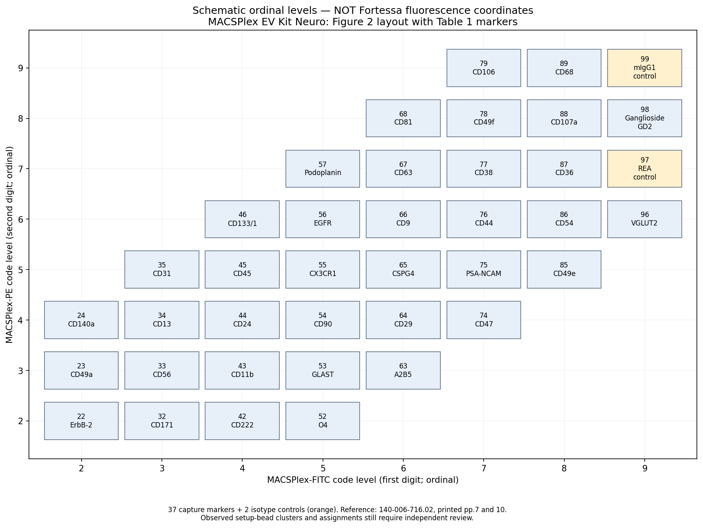

# Assigning the 39 bead populations

The required input types are **sample FCS files, an assay-blank FCS file, and a setup-bead FCS file**. “Reviewed gates” are definitions derived and checked during analysis of the setup-bead FCS; they are not an additional file you must obtain from the provider. A saved instrument workspace may help if available, but is optional.

## Figure 2 and Table 1

MACSPlex EV Kit Neuro manual **140-006-716.02**, Figure 2 (printed p.7; PDF p.4) places **FITC horizontally** and **PE vertically**. The first digit of each bead ID follows increasing FITC level; the second follows increasing PE level. Table 1 (printed p.10; PDF p.6) assigns the antibody to each ID. There are 37 capture-marker populations and two isotype populations.

This **ordinal identity map** combines Figure 2 and Table 1. It contains no Fortessa fluorescence values or gate boundaries. Blank cells are unused code positions, not missing biological markers. Equal table spacing must not be imposed on measured data.

| PE level ↑ / FITC level → | 2 | 3 | 4 | 5 | 6 | 7 | 8 | 9 |
| --- | --- | --- | --- | --- | --- | --- | --- | --- |
| 9 | | | | | | **79** CD106 | **89** CD68 | **99** mIgG1 control |
| 8 | | | | | **68** CD81 | **78** CD49f | **88** CD107a | **98** Ganglioside GD2 |
| 7 | | | | **57** Podoplanin | **67** CD63 | **77** CD38 | **87** CD36 | **97** REA control |
| 6 | | | **46** CD133/1 | **56** EGFR | **66** CD9 | **76** CD44 | **86** CD54 | **96** VGLUT2 |
| 5 | | **35** CD31 | **45** CD45 | **55** CX3CR1 | **65** CSPG4 | **75** PSA-NCAM | **85** CD49e | |
| 4 | **24** CD140a | **34** CD13 | **44** CD24 | **54** CD90 | **64** CD29 | **74** CD47 | | |
| 3 | **23** CD49a | **33** CD56 | **43** CD11b | **53** GLAST (ACSA-1) | **63** A2B5 | | | |
| 2 | **22** ErbB-2 (CD340) | **32** CD171 | **42** CD222 (IGF2R) | **52** O4 | | | | |

For example, **22 → 32 → 42 → 52** runs left-to-right at low PE, whereas **22 → 23 → 24** runs bottom-to-top at low FITC. Regions **96 VGLUT2**, **97 REA control**, **98 Ganglioside GD2**, and **99 mIgG1 control** occupy distinct PE levels in the rightmost FITC column. No identity should be assigned by APC brightness. Actual scale, spacing, spread and boundaries come from setup-bead events acquired on the Fortessa.

## Procedure from the supplied files

1. Inspect sample, blank and setup metadata for detector identity and acquisition/compensation information. Confirm compatible instrument settings and kit lot. Ask for additional acquisition information only if essential facts cannot be established from the files.
2. On setup-bead events, select beads and singlets and inspect FITC versus PE in a documented coordinate space. Identify the entire Figure 2 pattern and label all 39 populations. Use the surrounding pattern, not arbitrary clustering order or the number of clusters alone. Do not insert guessed populations when a region is unresolved.
3. Derive polygons around the observed populations and check their assignments against the ordinal reference and Table 1. Record gate version, review notes and a count threshold justified by pilot/acquisition guidance. No provider gate file is required. The current CLI produces overview plots and empty templates; it does not automatically derive or certify all 39 polygons from an arbitrary FCS file.
4. The pipeline checks **observed setup-bead FITC medians within each Figure 2 row** and **PE medians within each column**. Expected order must hold. This catches many swapped IDs or flipped/transposed patterns before sample APC results are calculated. Passing relative order is consistency evidence, not proof of identity or complete validation.
5. Apply the checked template to the matched blank and samples without relabeling regions per sample. Inspect overlays, missing regions, overlaps and shifts. Flag uncertainty rather than force an assignment.
6. Within each accepted population, measure **median APC**, then subtract that population's matched blank median. FITC/PE encode bead identity; APC supplies the EV detection signal.

The order check does not impose equal spacing, digit-valued intensities, or exact horizontal/vertical alignment. It uses assigned **event medians**, not polygon centers. It cannot detect every possible wrong assignment and cannot replace inspecting the real setup pattern. Controls and plots remain part of the evidence.

## The reported 5,000 beads per sample

The 5,000 beads are the **total per tube**, shared across all 39 populations. An equal split would average **5,000 / 39 ≈ 128 beads per population**. Actual counts are unequal, and any additional debris/singlet/ambiguity exclusions reduce accepted counts. A region can be sparse or missing despite an adequate total.

Assess actual accepted `n_events` in every population, the lower tail of that distribution, separation, APC spread and measurement stability. Do not assign 128 to every region, interpret region proportions as EV abundance, or judge sufficiency solely from the total. The supplied manual gives no numerical minimum per gate; the real-data configuration intentionally has no invented cutoff. More events may help sparse-region precision but cannot fix wrong identities or unresolved clusters.

## Generated evidence

`calibrate` writes `bead-identity-reference.png` and `bead-identity-reference.csv` alongside unreviewed templates. These are schematic identity guides, not executable gate coordinates.

`analyze` writes `bead_identity_audit.csv` for each setup reference, preserving expected ordinal levels, observed linear FITC/PE medians, accepted counts, ordering flags, record ID and setup ID. It stops on missing populations or inconsistent ordering before producing sample APC summaries, retaining the audit for investigation. The report embeds the reference and audit when present. Real sample behavior remains unvalidated until the supplied FCS files have been inspected and the derived assignments checked.
