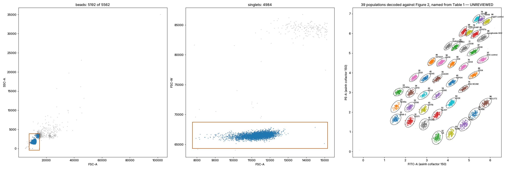

# Setup-bead identification, LSRFortessa acquisition of 29 October 2026

This records what `scripts/identify_setup_beads.py` found in the supplied setup-bead export and what remains for human review. The derived gates are **unreviewed**: `config/analysis.json` carries them with `reviewed: false`, an empty `gate_version` and no `min_events_per_population`, so `analyze` refuses to use them until those are set after inspection.

## Source file

| Item | Value |
| --- | --- |
| File | `20261029_Beads_5000.fcs` (tube `Beads_5000`, experiment `MACSPlex`) |
| SHA-256 | `9899f4c1c6843f74217b32b448bffb3dfa5fbd6ddac0e381adb570d64b8f916c` |
| Instrument / software | BD LSRFortessa, FACSDiva 9.0.1, FCS 3.0, float data, big-endian |
| Acquired | 29-OCT-2026 13:54:59 to 13:55:39; CST performance check passed 26-OCT-2026 |
| Parameters | FSC-A, FSC-H, FSC-W, SSC-A, APC-A, FITC-A, PE-A, Time |
| PMT voltages | FSC 150, SSC 120, FITC-A 280, PE-A 480, APC-A 520; threshold FSC 5000 |
| Compensation | `$SPILL` is the identity matrix over APC-A, FITC-A, PE-A with `apply compensation` TRUE; values are original detector values |
| Reader note | FACSDiva writes `$P8G/0.01/` for Time. The reader now tolerates a non-unit gain on the Time parameter only. |

## Gating and counts

| Stage | Events |
| --- | --- |
| Total | 5562 |
| Beads (FSC-A versus SSC-A, robust rectangle) | 5192 |
| Singlets (FSC-A versus FSC-W, robust rectangle) | 4984 |
| Assigned to a population | 4942 |
| Populations resolved | 39 of 39 |

The doublet population is visible as a second FSC-W band near 84,000 against 66,500 for singlets, and is excluded by the singlet gate.

## Decoded populations

Identities come from the Figure 2 staircase (FITC level is the first digit, PE level the second) matched to the 39 density peaks; names are the canonical Table 1 names from `config/panel.csv`. Medians are linear detector values of uniquely assigned singlet events. The pipeline's own `audit_identity` reports every population as `consistent`, with zero ambiguous events.

| ID | Marker | Events | FITC-A median | PE-A median | APC-A median |
| --- | --- | ---: | ---: | ---: | ---: |
| 22 | ErbB-2 | 114 | 333 | 371 | 40.6 |
| 23 | CD49a | 68 | 341 | 729 | 39.1 |
| 24 | CD140a | 141 | 383 | 1537 | 46.6 |
| 32 | CD171 | 136 | 682 | 335 | 35.6 |
| 33 | CD56 | 106 | 667 | 708 | 45.4 |
| 34 | CD13 | 129 | 703 | 1493 | 44.7 |
| 35 | CD31 | 146 | 824 | 3232 | 51.0 |
| 42 | CD222 | 144 | 1332 | 279 | 37.2 |
| 43 | CD11b | 127 | 1323 | 626 | 37.2 |
| 44 | CD24 | 67 | 1304 | 1322 | 44.1 |
| 45 | CD45 | 127 | 1406 | 3100 | 52.9 |
| 46 | CD133/1 | 159 | 1893 | 7234 | 62.4 |
| 52 | O4 | 139 | 2495 | 115 | 33.4 |
| 53 | GLAST | 123 | 2460 | 477 | 37.2 |
| 54 | CD90 | 73 | 2514 | 1314 | 42.2 |
| 55 | CX3CR1 | 170 | 2489 | 3036 | 49.8 |
| 56 | EGFR | 151 | 3012 | 7090 | 63.6 |
| 57 | Podoplanin | 131 | 4187 | 16037 | 75.6 |
| 63 | A2B5 | 127 | 4799 | 159 | 32.1 |
| 64 | CD29 | 168 | 4802 | 877 | 43.2 |
| 65 | CSPG4 | 113 | 4999 | 2524 | 54.2 |
| 66 | CD9 | 112 | 5042 | 6499 | 62.7 |
| 67 | CD63 | 132 | 5851 | 15420 | 73.1 |
| 68 | CD81 | 113 | 8747 | 33222 | 82.5 |
| 74 | CD47 | 151 | 8906 | 280 | 39.1 |
| 75 | PSA-NCAM | 125 | 8806 | 1827 | 45.4 |
| 76 | CD44 | 134 | 8618 | 5576 | 57.3 |
| 77 | CD38 | 122 | 8992 | 14174 | 73.1 |
| 78 | CD49f | 134 | 11092 | 32470 | 80.0 |
| 79 | CD106 | 132 | 16131 | 64356 | 89.1 |
| 85 | CD49e | 112 | 14323 | 491 | 36.9 |
| 86 | CD54 | 125 | 14020 | 3660 | 52.9 |
| 87 | CD36 | 118 | 13714 | 11873 | 70.9 |
| 88 | CD107a | 126 | 15099 | 29054 | 74.3 |
| 89 | CD68 | 110 | 19536 | 61507 | 87.6 |
| 96 | VGLUT2 | 140 | 24211 | 865 | 38.4 |
| 97 | REA control | 120 | 21421 | 8032 | 59.2 |
| 98 | Ganglioside GD2 | 144 | 21625 | 24217 | 68.7 |
| 99 | mIgG1 control | 133 | 26225 | 55757 | 85.1 |

## Observations for the reviewer

- **The layout is sheared, not rectangular.** Within a Figure 2 row, PE-A falls as the FITC level rises (for example 371, 334, 278 and 115 for IDs 22, 32, 42 and 52), and within a column FITC-A rises with the PE level. Rows and columns keep their Figure 2 order, which is what the identity audit checks, but the picture differs from the compensated MACSQuant plot in the manual.
- **The brightest FITC levels are compressed.** Along the top row the FITC-A medians of 79, 89 and 99 differ by factors of about 1.2 and 1.3, against about 1.65 per level elsewhere, consistent with PE-dye signal spilling into the FITC-A detector. IDs 79 and 89 are the closest pair in the gating space and deserve the closest look; their polygons are clipped at the bisector, so a few percent of their events fall into the gap and are reported as unassigned rather than ambiguous.
- **Counts are uneven.** Populations hold 67 to 170 events (median 127) from about 5,000 beads. The sparsest are 44 CD24, 23 CD49a and 54 CD90. Choose `min_events_per_population` with this spread in mind.
- **Saturation.** No APC-A event reaches the range limit; one PE-A event does. FITC-A peaks at 231,938 of 262,144.
- **Setup beads carry no detection signal.** APC-A medians of 32 to 89 are background, as expected for setup beads.
- **Scope.** These polygons belong to these voltages, this instrument configuration and this gating transform (asinh, cofactor 150). Re-derive them for any other setup, and compare them against the manufacturer's acquisition application note (130-122-211) before setting `reviewed: true`.
